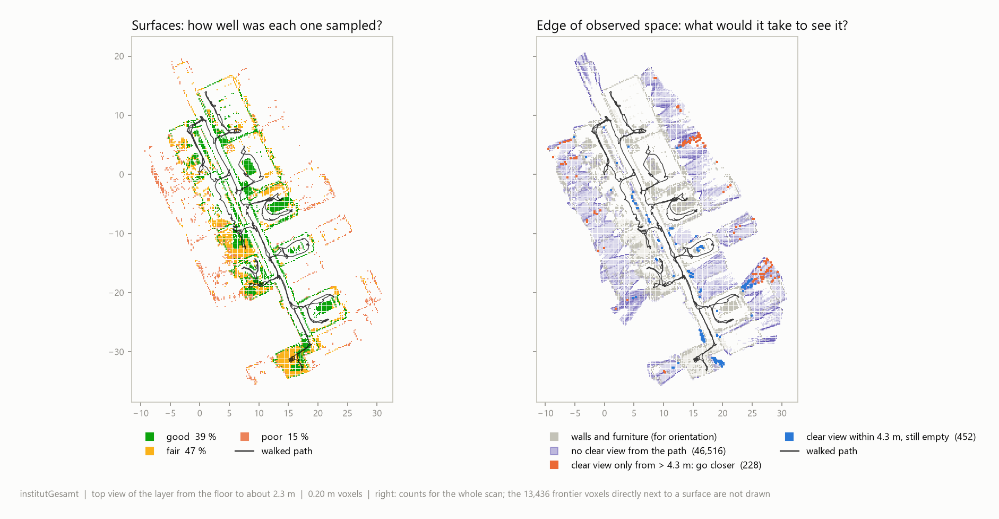
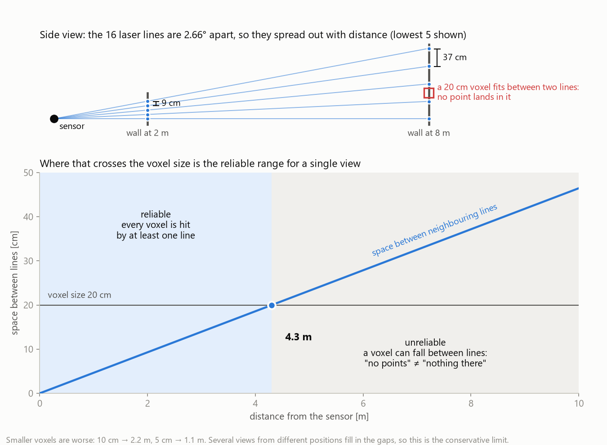
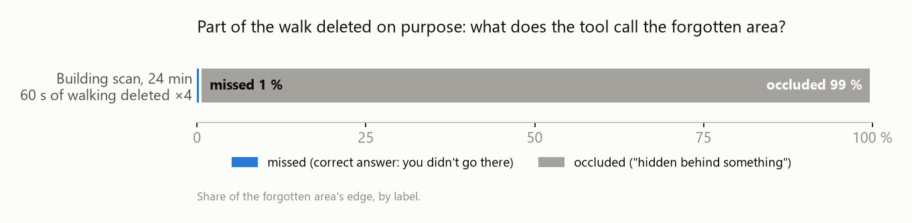

# P1 — Coverage assessment for mobile LiDAR scans

053021 Praktikum Informatik 1, 6 ECTS, Uni Wien MSc Informatik, 2026W.

From a scan and its trajectory: which surfaces were sampled well, which badly, and where observed space ends.

All results below are from `institutGesamt`, a 24-minute walkthrough of a building interior (14,460 sweeps, 68 M points).

## Findings

### 1. Surface quality is the most usable output

On the building scan 39 % of surfaces are good, 47 % fair and 15 % poor (density ≥ 2,000 pts/m², mean range ≤ 6 m, seen from ≥ 3 of 8 direction octants). The median surface was seen from 2 octants, at 3.4 m. The thresholds are my own, so the numbers are relative, not absolute.



*Left: surface grades. Right: where observed space ends, grouped by what it would take to see it. The grey on the right is the same surfaces as on the left, drawn only for orientation.*

### 2. The sensor sets the resolution

The sensor's 16 laser lines are 2.66° apart, so they spread out with distance: 9 cm apart on a wall 2 m away, 37 cm apart at 8 m. Beyond 4.3 m, a 20 cm voxel can sit between two lines and get no points although it is in plain view, so "no points" no longer means "nothing there". The limit is `voxel size / tan(2.66°)`, so smaller voxels are worse (5 cm → 1.1 m). In practice, anything that must be certified has to be walked past within about 4 m, or seen from several positions.



### 3. A skipped area cannot be told apart from an occluded one in a single scan

The tool separates *occluded* (behind something), *unsampleable* (beyond what the sensor resolves) and *missed* (in clear view, but not captured). To test whether *missed* finds a place the operator skipped, known stretches of the walk were deleted (their sweeps and positions), the tool was rerun, and its labels on the edge of the area that is now unseen were checked. The correct answer there is *missed*, and the ground truth is exact.



| deleted | observed volume lost | edge called "missed" (correct) | gap clusters on the forgotten area |
|---|---|---|---|
| 4 × 60 s (16–24 m of walk) | 18–43 m³ | 0–2 % (mean 1 %) | 0 of 11 |

The tool calls almost all of it *occluded*, the same label it gives the far side of a wall. A stricter single-view rule gives the same picture (under 1 %). None of the simple per-voxel measures separates the forgotten area's edge from the rest of the frontier either: distance to the path scores AUC 0.34–0.83 across the four deletions, with no consistent direction, and clear-view distance, number of clear views and adjacency to a surface stay at 0.49–0.56 (0.5 = chance). What does mark it is a *change* between two states: 93–95 % of the frontier that appears after the deletion lies on the forgotten area.

**Interpretation.** A 360° LiDAR samples whatever is in clear view within reach. So a region that stays empty despite a clear view points to the sensor or the scene (ring gaps, reflective or transparent material, a person in the way), and a place the operator skipped looks like any other edge of observed space. In the building scan 77 % of the frontier has no clear view from the nearby path; judging from the map, most of it is the far side of walls and floors and the outside.

## Pipeline

```
Raven handheld walk
   └─► <scan>\LIDAR_*.bag                       (IMAGE_*.bag is recorded but not used)
          │
          ├─ step 2: RayStudio "Data Processing"  (vendor, LiDAR+IMU SLAM, once per scan)
          │     └─► recalculate_trj.txt           sensor pose at 200 Hz
          │
          └─ step 3: coverage.py (bag + trajectory)   ~6.5 min for the 24-min building scan
                └─► out\<scan>\ coverage.json · gaps.json · coverage_voxels.ply · octree.bt
                        ├─ step 4: CloudCompare   look at the coloured voxels
                        └─ step 5: experiments\   validation and prototypes (not part of the tool)
```

### Step 0 · Capture

Walk through the building with the Raven. Each walk becomes one scan folder; copy it into this folder (e.g. `institutGesamt\`). Only the LiDAR bag is used: `/vanjee_722z` at 10 sweeps/s with about 4,700 points each (fields `x y z intensity ring timestamp`), plus the IMU at 200 Hz. Device: Vanjee WLR-722Z, 16 rings 2.66° apart, vertical field of view −0.2° to +40.2° in the sensor's own frame. The device is held tilted (median 42° from vertical, between 11° and 76° for 90 % of the walk), so in the world frame it also sees below the horizontal.

### Step 1 · Check the bag (optional)

```powershell
& $py check_bag.py --scan institutGesamt
```

Lists topics and message counts (like `rosbag info`, no ROS needed) and writes one sweep to `out\<scan>_scan0.ply`.

### Step 2 · Trajectory (RayStudio)

In RayStudio run `Data Processing` with Scene Type Indoor, Coloring off, Resolve Image off, Filter Medium, GPU on. It fuses LiDAR and IMU and writes into the scan folder:

- `recalculate_trj.txt`: the trajectory. One row every 5 ms (200 rows per second), TUM format:

  ```
  timestamp            tx       ty       tz        qx       qy       qz        qw
  1785499438.004691    0.003622 0.000240 0.014054  0.260965 0.003721 -0.000566 0.965341
  ```

  `timestamp` is Unix time in seconds. `tx ty tz` is the sensor position in metres, in a map frame that starts where the scan started. `qx qy qz qw` is the sensor orientation as a quaternion. The example row, at the start of `institutGesamt` with the device standing still, is a rotation of about 30° about x: the device tilt.
- `recalculate_result.pcd`: the vendor's registered cloud (not needed; useful as a cross-check).

**Know about this file:** it is the live output of the vendor's LiDAR-IMU filter, not a smoothed trajectory. Between LiDAR updates the pose is extrapolated from the IMU for 0.1 s, then corrected when the next sweep is registered, so it **jumps once per sweep**. On the building scan the typical jump is ~0.7 cm and ~0.2°, and at most about 6 cm and 2°. The jumps fall 25–30 ms *into* each sweep, so a sweep contains one small seam. At 5 m that shifts points by ~2 cm on median (below the 10 cm octree) and up to ~6 cm at the 99th percentile.

### Step 3 · Analysis (`coverage.py`)

```powershell
& $py coverage.py --scan institutGesamt         # 24-min building scan, ~6.5 min
```

| Stage | What happens |
|---|---|
| 1 · Trajectory | load the 200 Hz poses |
| 2 · Octree | for each sweep, keep points 0.4–15 m away. Give **every point its own pose** by interpolating the trajectory at that point's timestamp (linear for position, SLERP for rotation), because the sensor moves during the 0.1 s sweep. Transform to world coordinates and insert into OctoMap at 0.10 m, in 5 time slices, each with its sensor position. OctoMap ray-casts each beam: cells along it become *free*, the cell at its end *occupied*. For each point also record its 0.20 m voxel, its range and its viewing direction (one of 8 octants). The field of view and ring spacing are measured from the first 50 sweeps |
| 3 · Domain | 0.20 m analysis grid, restricted to within 8 m of the walked path |
| 4 · Classify | each grid voxel reads the octree cell at its centre: occupied, free or unknown |
| 5 · Frontier | frontier = unknown voxels touching free space, where observation stopped. For each: up to 12 nearby sensor positions that had it in their field of view, one ray from each. A ray is *clear* only if it reaches the voxel. No clear ray → **occluded**; only far views, so it probably fell between rings → **unsampleable**; touches a surface → **occluded**; otherwise → **missed** |
| 5b · Surface quality | per occupied voxel: density (pts/m²), mean range, number of octants → **good** (≥ 2,000 pts/m², ≤ 6 m, ≥ 3 octants) / **fair** (≥ 500 pts/m², ≤ 12 m) / **poor** |
| 6 · Output | group adjacent missed voxels into gaps (≥ 8 voxels) and write the files |

Useful options: `--grid`, `--res`, `--radius`, `--q-density`, `--stride N` (every N-th sweep, faster and lower memory, pessimistic numbers), `--no-slerp` (one pose per sweep, for comparison).

### Step 4 · Outputs

| File | Contents |
|---|---|
| `coverage.json` | all numbers (building: surfaces 39 / 47 / 14 %, 588 missed voxels, 5 gaps, all ≤ 0.1 m³) |
| `gaps.json` | ranked candidate gaps: centre, size, volume |
| `coverage_voxels.ply` | open in CloudCompare. Green good, yellow fair, orange poor, grey occluded, blue unsampleable, red missed |
| `octree.bt` | the saved occupancy map |

### Step 5 · Experiments (validation, run separately)

```
cov_lib.py      the same method as functions, with switches (delete part of the walk, classification rules)
   └─ ablation.py     full run + one run per deleted time window  → abl_<scan>\
         ├─ posthoc.py + make_table.py    AUC scores and the table above
         └─ fig_*.py                      the figures in ..\figures\
regions.py      prototype of the two-layer output → regions_institutGesamt.json
test_castray.py OctoMap castRay return values
check_body.py   close-range returns by direction (operator-body hypothesis)
inspect_gap.py, inspect_blue.py   compare a region with the vendor cloud and the nearest camera frame
                                  (frames show people; written to a temp folder outside the repository)
```

```powershell
cd experiments
& $py ablation.py institutGesamt 60 "200,500,800,1100"   # ~25 min, ~4 GB RAM
& $py posthoc.py institutGesamt; & $py make_table.py institutGesamt
& $py regions.py institutGesamt 8
& $py fig_sensor.py; & $py fig_map.py institutGesamt; & $py fig_ablation.py institutGesamt
```

`cov_lib.py` aligns the grid to multiples of the voxel size, so it reads a different sub-cell per voxel than `coverage.py`. Counts differ slightly (surfaces poor 15 % against 14 %); the conclusions do not depend on it.

## Scanner

3DMakerpro Raven Max RTK (SN JMK6000768)

https://store.3dmakerpro.com/products/raven?variant=44701133013061

| Spec | Value |
|---|---|
| Accuracy | 2 cm @ 10 m / 3 cm @ 20 m / 5 cm @ 40 m |
| Scan radius | 40 m @ 10 % reflectivity / 50 m @ 80 % reflectivity |
| Scan range (diameter) | 80–100 m |
| Field of view | 360° horizontal × 40° vertical |
| Point rate | 150,000 pts/s |
| Laser | 905 nm, Class 1 (IEC 60825-1:2014) |
| Minimum range | 50 cm |
| Cameras | 2 × 12 MP, 1/2″ Sony sensors, 4K colour |
| Positioning | integrated GNSS with RTK, centimetre-level absolute positioning when RTK corrections are received |
| Processor / storage | 8-core 2.4 GHz, 32 GB, TF card (128 GB included) |
| Display | 3.9″ AMOLED, 700 nits |
| Battery | 12,000 mAh grip, up to 2 h, can charge while running, PD 65 W USB-C |
| Interfaces | USB-C, Wi-Fi 5 |
| Export formats | LAS/LAZ, PCD, PLY, OBJ, E57, XYZ, Gaussian splat (PLY) |
| Operating temperature | 0–35 °C, down to −10 °C in extreme cases |
| Weight | scanner about 1.1 kg; the 2.45 kg listed includes accessories |
| Kit size | 31 × 22 × 12 cm |
| Software | RayStudio, Windows 11 or later (no macOS) |
| Warranty | 2 years |
| In the box | scanner, battery grip, holder base, protective case, 128 GB TF card, RTK kit, TF card reader, hard-shell carrying case |

## Setup

Python 3.12 (Python 3.14 has no wheels for `open3d`, `kiss-icp` or `octomap-python`):

```powershell
py -3.12 -m venv .venv
.venv\Scripts\pip install -r requirements.txt
$py = (Resolve-Path .venv\Scripts\python.exe).Path
```

## Folder

| Path | Contents |
|---|---|
| `coverage.py`, `check_bag.py` | the tool, the bag check |
| `step0_slam.py` | LiDAR-only KISS-ICP baseline for the trajectory |
| `<scan>\` | raw scan, e.g. `institutGesamt\` (12.6 GB, not in the repository) |
| `out\<scan>\` | outputs (see step 4) |
| `figures\` | figures used above |
| `experiments\` | validation code and results (see step 5) |

Main scan: `institutGesamt` (24 min, interior walkthrough). Only `LIDAR_*.bag` and `recalculate_trj.txt` are needed. `IMAGE_*.bag` is not used, and its frames show people.
